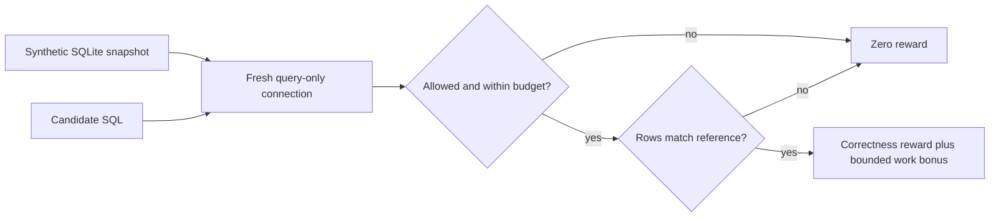

# SQL Result Verifier

Score candidate SQL by what it returns, rather than merely whether it executes. A fictional sales example exposes missing filters, wrong regions, duplicate joins and attempted writes. Different SQL strings can earn the same reward when they return the correct result.

The verifier opens a fresh in-memory SQLite snapshot for each query, enables query-only mode, installs an action/function allowlist, and bounds SQL length, result rows, VM instructions and elapsed execution time. It compares exact result multisets, preserving duplicates and NULLs; optional ordered comparison requires matching row order. Correctness gates a small efficiency bonus based on VM instructions. An incorrect query always receives zero, and a correct query always receives at least one. The instruction counter is a SQLite work proxy, not bytes scanned or a cross-database latency benchmark.

This is a runnable local reward-design exercise. It does not train an LLM, implement GRPO optimization, submit SageMaker jobs, provision resources, or reproduce an AWS evaluator deployment. Fixture results are not held-out model-quality evidence. Exact numeric equality and column position are intentional; configure a task-specific comparison before using other schemas or SQL dialects. Result agreement on one fixture does not prove query equivalence on every database. SQLite authorizers and resource limits help constrain this demonstration but do not provide process-level isolation for arbitrary hostile workloads.

## Run

Python 3.11+ with SQLite serialization support; no packages, credentials or external database.

```powershell
python -m pip install -r requirements.txt
python app.py
python app.py --sql "SELECT sum(cents) FROM sales WHERE region='west' AND day LIKE '2026-01-%'"
python -m unittest discover -s tests -v
```

The demo reports a 5,000-cent reference total, two passing candidates and four rejected/incorrect candidates. A single-query run exits 1 for an incorrect result. All tables and records exist only in memory; the CLI cannot connect to a local or production database. Invalid reference queries abort scoring instead of producing misleading rewards.

## CODE MAP

| File | Responsibility |
|---|---|
| `verifier.py` | Creates the synthetic serialized fixture, constrains query execution, compares rows, and computes gated rewards. |
| `app.py` | Defines the reference question/candidate SQL and exposes a JSON CLI demonstration. |
| `tests/test_verifier.py` | Checks equivalent queries, wrong answers, duplicates/order/NULLs, rejected writes, limits and invalid references. |
| `requirements.txt` | Documents the standard-library runtime. |
| `.gitignore` | Excludes bytecode, databases, secrets and generated output. |



## References

- [SQLite authorization callbacks](https://www.sqlite.org/c3ref/set_authorizer.html)
- [Python sqlite3 connection APIs](https://docs.python.org/3/library/sqlite3.html)
- [SageMaker serverless model customization](https://docs.aws.amazon.com/sagemaker/latest/dg/customize-model.html)
- [Open-source SageMaker customization workshop](https://github.com/aws-samples/generative-ai-on-amazon-sagemaker/tree/main/workshops/serverless-model-customization-with-sagemaker-ai), for the larger managed-training lifecycle.
